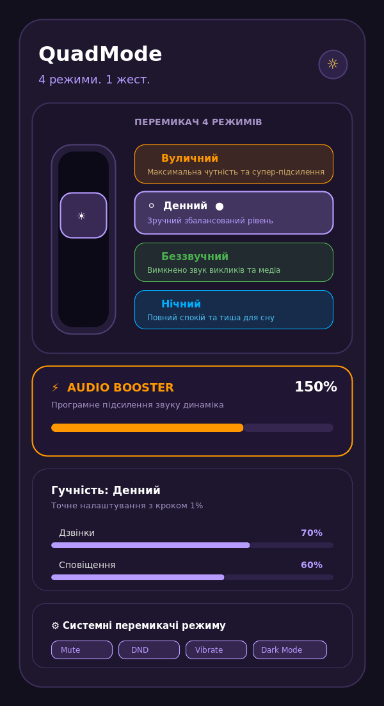
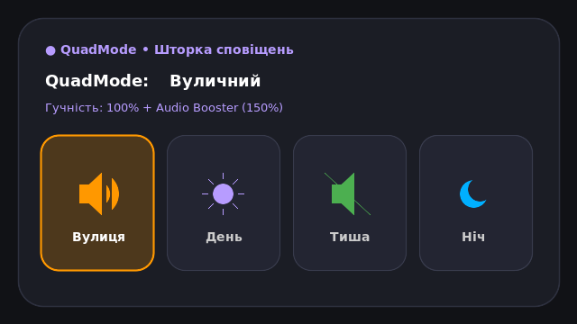

# QuadMode 🎛️

> **4 режими. 1 жест.**  
> Швидкий перемикач життєвих сценаріїв та звукових профілів смартфона.

[](https://android.com)
[](https://kotlinlang.org)
[](https://developer.android.com/jetpack/compose)
[](https://developer.android.com/topic/architecture)

---

## 💡 Позиціонування

**QuadMode — це не регулятор гучності.**  
Це швидкий перемикач життєвих сценаріїв вашого смартфона.

Замість щоденного налаштування десятків повзунків та блукання в системних параметрах, ви обираєте один із чотирьох заздалегідь підготовлених режимів, а додаток миттєво застосовує весь набір звукових і системних налаштувань.

---

## 📸 Скріншоти додатку

<p align="center">
  
  <br />
  <em>Головний інтерфейс QuadMode: 4-позиційний вертикальний тумблер, Audio Booster та персональні налаштування</em>
</p>

<p align="center">
  
  <br />
  <em>Швидке перемикання 4 режимів з іконками прямо зі шторки сповіщень</em>
</p>

---

## 🎛️ 4 Життєві Режими

| Режим | Колір | Іконка | Призначення |
| :--- | :---: | :---: | :--- |
| **Вуличний (`Outdoor`)** | 🟠 Помаранчевий | 🔊 | Максимальна гучність викликів та блок **Audio Booster (до 200%)** для галасливих місць, вулиці та транспорту. |
| **Денний (`Day`)** | ⚪ Білий / Лаванда | ☀️ | Комфортний, збалансований рівень звуку для щоденних справ, роботи та дзвінків. |
| **Беззвучний (`Silent`)** | 🟢 Зелений | 🔇 | Повна тиша (0% звуку) для нарад, зустрічей, театру чи лекцій (з опціональним вібро-відгуком). |
| **Нічний (`Night`)** | 🔵 Блакитний | 🌙 | Глибокий спокій для сну: автоматичний перехід у режим «Не турбувати» (DND) та вимкнення зайвих звуків. |

---

## ⚡ Ключові можливості

### 1. Вертикальний 4-позиційний студійний тумблер
- Тактильний перемикач у стилі професійного аудіо-обладнання з плавним пружинним ходом бігунка та світлодіодним кристалом.
- Підтримує як швидке пряме натискання на будь-який режим, так і плавне вертикальне перетягування бігунка з магнітним притягуванням.

### 2. Audio Booster (Надгучність до 200%)
- Окремо виділений модуль програмного посилення динаміка (діапазон 100% – 200%) з неоновим індикатором та швидкими пресетами (+25%, +50%, +100%).

### 3. Точність 1% та кнопки «Тест» для кожного аудіопотоку
- Індивідуальні повзунки для **Дзвінків**, **Сповіщень** та **Музики** з точним кроком у 1% та кнопками мікро-налаштування `-` / `+`.
- Кнопка **«▶ Тест»** біля кожного повзунка дозволяє миттєво прослухати системний рингтон або звук сповіщення перед збереженням.

### 4. 8 Системних перемикачів для кожного режиму
Прив'язка системних станів смартфона до конкретного профілю:
- 🔇 **Mute** (глушіння)
- 🔕 **DND** (режим «Не турбувати»)
- 📳 **Vibrate** (вібрація)
- 🌙 **Dark Mode** (темна тема)
- 💡 **Auto Brightness** (автояскравість)
- 🔋 **Battery Saver** (економія заряду)
- 📖 **Reading Mode** (режим читання / захист зору)
- ✈️ **Airplane Mode** (режим «У літаку»)

### 5. Сценарії та розклад за днями тижня
- Налаштування автоматичного вмикання профілю за часом (початок і кінець) з вибором активних днів тижня (Пн, Вт, Ср, Чт, Пт, Сб, Нд).

### 6. Швидке керування у шторці сповіщень
- Кастомний віджет із 4 окремими кнопками-іконками — зміна режиму в 1 дотик навіть із заблокованого екрана.

### 7. Світла та Темна теми
- Швидкий перемикач теми (Сонце / Місяць) у шапці додатку на базі палітри темного графіту (`#1E1F24`) та цифрової лаванди (`#B79CFF`).

---

## 🛠️ Архітектура та стек технологій

- **Мова:** Kotlin 100%
- **UI:** Jetpack Compose з Material Design 3 (M3)
- **Архітектура:** MVVM (Model-View-ViewModel) + Clean Architecture
- **Асинхронність:** Kotlin Coroutines & `StateFlow`
- **Збереження даних:** Jetpack DataStore Preferences (асинхронне збереження профілів)
- **Системні API:** Android `AudioManager`, `NotificationManager`, `RingtoneManager`
- **Тестування:** Robolectric JVM-тести бізнес-логіки та ресурсів

---

## 📦 Встановлення та запуск

### Завантаження готового APK:
Файл **`QuadMode.apk`** знаходиться безпосередньо в корені репозиторію. Завантажте його на Android-смартфон та встановіть в один клік.

### Збірка з вихідного коду:
```bash
# Клонувати репозиторій
git clone https://github.com/<your-username>/QuadMode.git
cd QuadMode

# Зібрати налагоджувальний APK
gradle :app:assembleDebug

# Запустити модульні тести
gradle :app:testDebugUnitTest
```
Зібраний APK знаходитиметься за шляхом:
`app/build/outputs/apk/debug/app-debug.apk`

---

## 📄 Ліцензія
Розповсюджується під ліцензією MIT. Деталі дивіться у файлі ліцензії.
